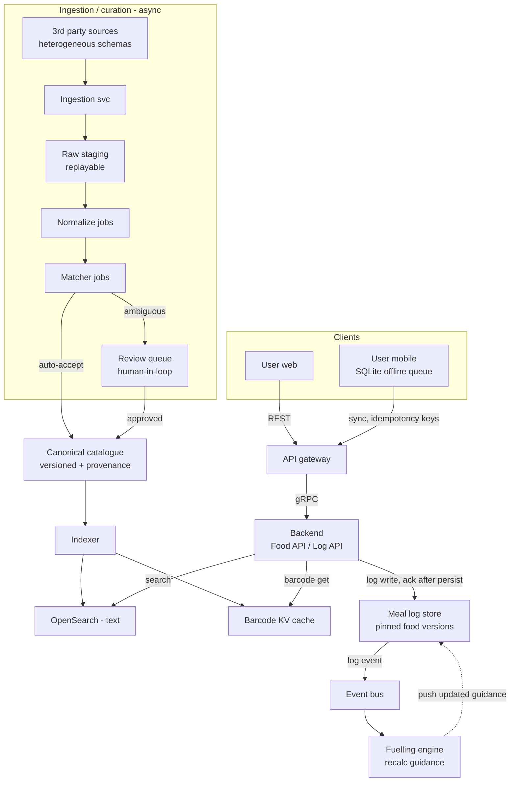

# Hexis food platform v2 — target architecture

Interactive original (Excalidraw): https://link.excalidraw.com/readonly/zW85ffCvKDKQFeIyNFUZ?darkMode=true

The matcher in this repo is the "Matcher jobs" box: it runs async in the
ingestion/curation pipeline, auto-accepts only on overwhelming agreement,
and routes ambiguity to the human-in-the-loop review queue. The canonical
catalogue is versioned with provenance so meal logs can pin food versions.

